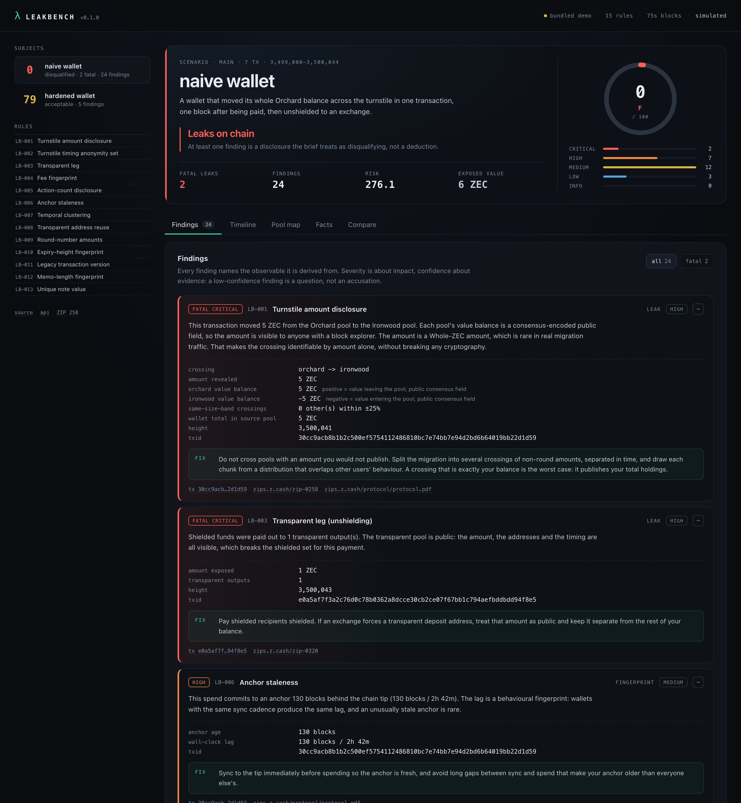
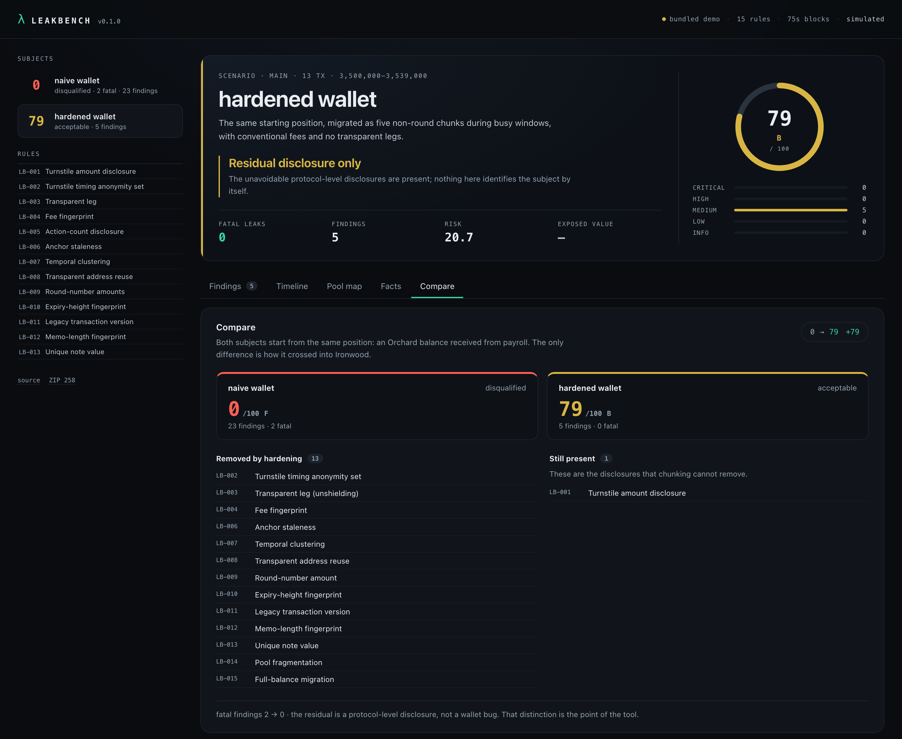
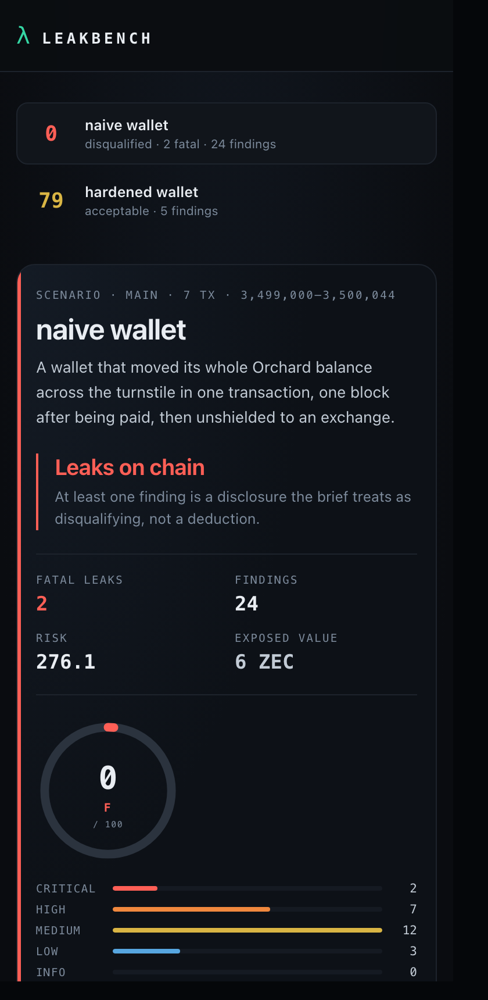

# LeakBench

**A leak oracle for Zcash.** Facts in, findings out.

Shielded pools hide the sender, the recipient and the amount *inside* the pool. They do not hide
the edges. Every crossing between pools publishes an amount through `valueBalance`, every fee is a
software fingerprint, every cluster of activity in a handful of blocks is a group, and every
migration from Orchard to Ironwood is a moment where a wallet's entire history meets a new
identity.

The Zcash ecosystem is in the middle of exactly that migration — Ironwood (NU6.3) activated in July
2026 and the turnstile is still draining Orchard ([ZIP 258](https://zips.z.cash/zip-0258)) — while
NU7 arrives on 5 November 2026 with 25-second blocks that make timing correlations sharper
([ZIP 259](https://zips.z.cash/zip-0259), [ZIP 218](https://zips.z.cash/zip-0218)).

LeakBench is the tool that tells you what your wallet just published.



---

## The short version

```
naive wallet       0 / 100   F   disqualified    2 fatal, 24 findings
hardened wallet   79 / 100   B   acceptable      0 fatal,  5 findings
```

Same starting position: an Orchard balance received from payroll. The naive wallet crosses the
turnstile once, one block after being paid, for its whole balance, then unshields to an exchange.
The hardened wallet crosses in five non-round chunks during busy windows, with conventional fees
and no transparent legs.

Both wallets leak something, because `valueBalance` is a public consensus field. The difference the
tool makes is between **a disclosure that identifies you** and **a number lost in a crowd** — which
is the difference between a disqualifying leak and a residual cost of using the protocol.



The UI is responsive down to a 390px viewport: the pool map and tables scroll inside their own
containers rather than widening the page, and the tab strip scrolls horizontally.



---

## Quickstart

```bash
cargo run -p leakbench-cli -- demo --out reports          # write both scenarios
cargo run -p leakbench-cli -- serve --dir reports         # http://127.0.0.1:8787
```

Or open `web/dist/index.html` directly: the build inlines everything, so it works from disk with no
server. The UI prefers the live API and falls back to the bundle.

Console report for a single subject:

```bash
cargo run -p leakbench-cli -- simulate --scenario hardened
```

Scan a transaction you have JSON for (the output of `getrawtransaction <txid> 1`):

```bash
cargo run -p leakbench-cli -- scan --decoded tx.json --out report.json
cargo run -p leakbench-cli -- ci --report report.json --fail-on high
```

Scan from a local node:

```bash
cargo run -p leakbench-cli -- doctor --rpc http://127.0.0.1:18232
cargo run -p leakbench-cli -- scan --rpc http://127.0.0.1:18232 --txid <txid>
```

---

## The fifteen rules

| id | rule | category | what it sees |
|----|------|----------|--------------|
| LB-001 | Turnstile amount disclosure | leak | `valueBalance` publishes the amount of every pool crossing; fatal when the amount is round, is the whole balance, or has no peer in its size band |
| LB-002 | Turnstile timing anonymity set | linkage | how many *other* crossings share the window; a crossing alone in its hour is a crossing with no anonymity set |
| LB-003 | Transparent leg | leak | shielded value entering or leaving the transparent pool publishes its amount and addresses |
| LB-004 | Fee fingerprint | fingerprint | a fee that deviates from ZIP 317 identifies the wallet software |
| LB-005 | Action-count disclosure | fingerprint | bundle action counts reveal how many notes were spent |
| LB-006 | Anchor staleness | fingerprint | anchor lag fingerprints the wallet's sync cadence |
| LB-007 | Temporal clustering | linkage | several transactions inside a few blocks group trivially |
| LB-008 | Transparent address reuse | linkage | one reused t-address links everything that touched it |
| LB-009 | Round-number amounts | fingerprint | whole-ZEC public amounts are rare and therefore identifying |
| LB-010 | Expiry-height fingerprint | fingerprint | setting `nExpiryHeight` where others do not narrows the set |
| LB-011 | Legacy transaction version | hygiene | v4 is invalid at NU7 and a pre-NU7 fingerprint |
| LB-012 | Memo-length fingerprint | fingerprint | memo size classes reveal message types |
| LB-013 | Unique note value | linkage | a note nobody else holds is followable by amount |
| LB-014 | Pool fragmentation | fingerprint | a wallet in three pools documents its own migration |
| LB-015 | Full-balance migration | leak | a crossing equal to the entire balance links the new account to the old one |

`leakbench heuristics` prints this list; `docs/HEURISTICS.md` has the full rationale, false-positive
behaviour and remediation for each one.

---

## Design principles

1. **Facts, not raw bytes.** The engine consumes a normalized `TxFacts` bundle and never parses
   consensus encodings itself. A privacy analyzer that mis-parses a transaction produces confident
   nonsense; using the node's own decoder removes the whole failure class.
2. **Evidence over verdicts.** Every finding names the observable it came from, so it can be checked
   by hand. There is no opaque score without a reason behind it.
3. **Confidence is separate from severity.** "This is fatal if true" and "this is probably true" are
   different statements and are rendered differently.
4. **The tool does not leak you.** No telemetry, no uploads, no remote RPC (localhost or an SSH
   tunnel only), viewing keys never leave the process.
5. **Deterministic demos.** The scenarios are seeded, so reports diff cleanly and screenshots are
   reproducible.

## What it is not

- Not a deanonymizer. It reports heuristics, not proofs, and says so in every report.
- Not a wallet and not a node. It reads what already exists.
- Not a chain-wide anonymity-set engine yet. The peer sample is caller-supplied; when it is absent,
  rules that need an anonymity set lower their confidence instead of guessing.

---

## Repository layout

```
crates/
  leakbench-core/    facts, model, 15 heuristics, scoring, engine   (no I/O, no chain deps)
  leakbench-sim/     deterministic naive + hardened scenarios
  leakbench-chain/   fixtures, node-JSON decoder, localhost RPC, devnet recipes
  leakbench-cli/     scan · simulate · demo · serve · ci · schema · doctor · devnet
web/                 React + Vite report UI (self-contained build in web/dist)
docs/                architecture, heuristic catalogue, fact schema, demo script
fixtures/            hand-written fact bundles (one fatal, one clean)
scripts/             devnet and demo helpers
.github/workflows/   the CI gate
```

## Building

```bash
cargo test --workspace
cargo build --release
cargo install --path crates/leakbench-cli   # puts `leakbench` on PATH
cd web && pnpm install && pnpm build
```

Two fixtures ship with the repo: `fixtures/example-crossing.json` (fatal amount disclosure) and
`fixtures/clean-payment.json` (100/100). They double as the format's documentation.

`pnpm build` typechecks, bundles, and inlines everything into a single 300 KiB
`web/dist/index.html`, so the report UI can be opened from disk or emailed to a judge.

## Local chain

`scripts/devnet.sh` and `leakbench devnet` print a verified Zebra Regtest recipe (Regtest network,
internal miner, RPC on `127.0.0.1:18232`). Be aware of two things before you start:

- **`zcash-devtool` has no local-network or regtest subcommand.** It is a wallet for public light
  wallet servers (`-s zecrocks`), which makes it the wrong tool for standing up a chain.
- Zebra Regtest does mine blocks locally, but constructing *shielded* transactions against it needs
  a wallet that targets Regtest, which `zcash-devtool` does not.

That is why LeakBench does not depend on a devnet: the simulator and fixtures produce identical
report shapes with no infrastructure, and the RPC path analyzes whatever your node already has.

## License

MIT. See [LICENSE](LICENSE).
